# Procesador RISC-V single-cycle en SystemVerilog

Parcial 4 – Arquitectura de Computadoras, UNIS.
Autor: José Rueda (carné 18123).

Procesador RISC-V de **un solo ciclo** (single-cycle) descrito en SystemVerilog, basado en el capítulo 7 de *Digital Design and Computer Architecture* (Harris & Harris) y en el repositorio de referencia indicado en el curso. Cada instrucción se completa en un ciclo de reloj: fetch, decode, execute, memory y write-back.

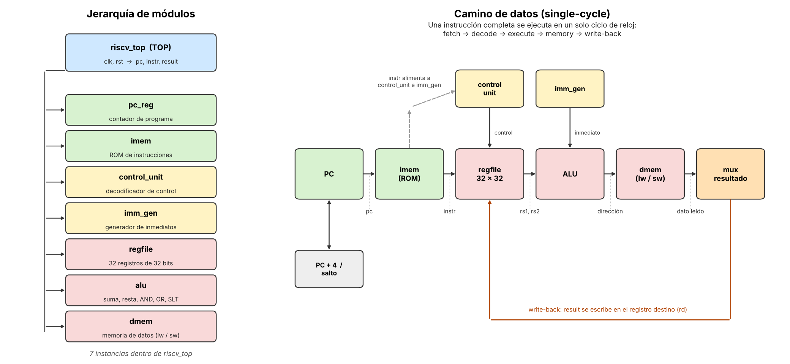

## Instrucciones soportadas

Se implementó el subconjunto del video, más `addi` y `jal`, que el mismo video presenta como las siguientes en agregarse.

| Tipo | Instrucciones |
|---|---|
| Aritmético-lógicas (R) | `add`, `sub`, `and`, `or`, `slt` |
| Con inmediato (I) | `addi` |
| Memoria | `lw`, `sw` |
| Saltos condicionales (B) | `beq` |
| Salto incondicional (J) | `jal` |

Una instrucción no soportada se ejecuta como si fuera un NOP: no escribe registros ni memoria.

## Archivos

| Archivo | Descripción |
|---|---|
| `riscv_top.sv` | **TOP**. Conecta todos los bloques. Puertos: `clk`, `rst`, y salidas de observación `pc`, `instr`, `result`. Parámetro `DMEM_WORDS` (por defecto 16) |
| `pc_reg.sv` | Contador de programa, reset síncrono |
| `imem.sv` | Memoria de instrucciones (ROM combinacional con el programa de prueba) |
| `control_unit.sv` | Decodificador principal y decodificador de la ALU |
| `imm_gen.sv` | Generador de inmediatos (tipos I, S, B y J) |
| `regfile.sv` | Banco de 32 registros de 32 bits, 2 lecturas combinacionales y 1 escritura síncrona; `x0` siempre vale 0 |
| `alu.sv` | ALU: suma, resta, AND, OR y SLT con signo |
| `dmem.sv` | Memoria de datos (lectura combinacional, escritura síncrona) |
| `tb_riscv_top.sv` | Testbench autoverificable |
| `expected.svh` | Valores esperados (registros y memoria) generados por el simulador de referencia |
| `gen_program.py` | Mini ensamblador RV32I + simulador de referencia en Python; genera `imem.sv`, `expected.svh` y `program.hex` |
| `program.hex` | Programa de prueba en hexadecimal |
| `files.f` | Lista de archivos para VCS |
| `resultado_simulacion_*.log` | Salida de las simulaciones |

## Programa de prueba

El programa (41 instrucciones, 73 ciclos hasta su bucle final) ejercita todas las instrucciones:

- Operaciones aritmético-lógicas con valores positivos y negativos (`add`, `sub`, `and`, `or`, `slt` con signo).
- `sw` y `lw` con comprobación de lo leído.
- `beq` tomados y no tomados (cuatro en el código, uno de ellos dentro del bucle).
- `jal` con enlace.
- Un bucle que suma 10 + 9 + ... + 1 y guarda **55** en la memoria de datos.

## Cómo verificarlo

El testbench ejecuta el programa hasta el bucle final y compara **todos los registros escritos y la memoria de datos** contra los valores que calcula el simulador de referencia en Python (`gen_program.py`), que es independiente del RTL. Termina con la línea `Errores: N`.

### Icarus Verilog

```sh
iverilog -g2012 -o sim.vvp -s tb_riscv_top pc_reg.sv regfile.sv imm_gen.sv alu.sv control_unit.sv dmem.sv imem.sv riscv_top.sv tb_riscv_top.sv
vvp sim.vvp
```

### Synopsys VCS / Verdi

```sh
vcs -full64 -sverilog -kdb -debug_access+all -f files.f -o simv
./simv -no_save
verdi -dbdir simv.daidir -ssf dump_riscv.fsdb &
```

### AMD Vivado

Se creó un proyecto RTL para el Artix-7 `xc7a35tcpg236-1`. Archivos de diseño: los 8 `.sv` del procesador (`riscv_top` como top). Archivos de simulación: `tb_riscv_top.sv` y `expected.svh`. Restricción de reloj en `riscv.xdc`:

```
create_clock -period 12.000 -name clk [get_ports clk]
```

## Resultados

### Verificación funcional

| Herramienta | Resultado |
|---|---|
| Icarus Verilog 12 | `Errores: 0` (73 ciclos, 776 ns) |
| Synopsys VCS X-2025.06-SP2-6 | `Errores: 0` (73 ciclos, 776 ns) |
| Vivado Simulator 2025.1 | `Errores: 0` (73 ciclos, 776 ns) |

Para comprobar que el testbench detecta fallas, se introdujeron 7 errores a propósito en el diseño (`sub` implementado como suma, `slt` sin signo, `beq` invertido, `jal` que guarda el PC equivocado, inmediato de `sw` mal armado, `or` implementado como `and` y `lw` que devuelve la salida de la ALU). El testbench detectó los 7.

### Evidencia de VCS y Verdi

Primeras instrucciones: `pc` avanza de 4 en 4, `instr` muestra cada instrucción y `result` el dato que se escribe (10, 5, 15, 5, 0, 15, 1, 0, -3, ...).

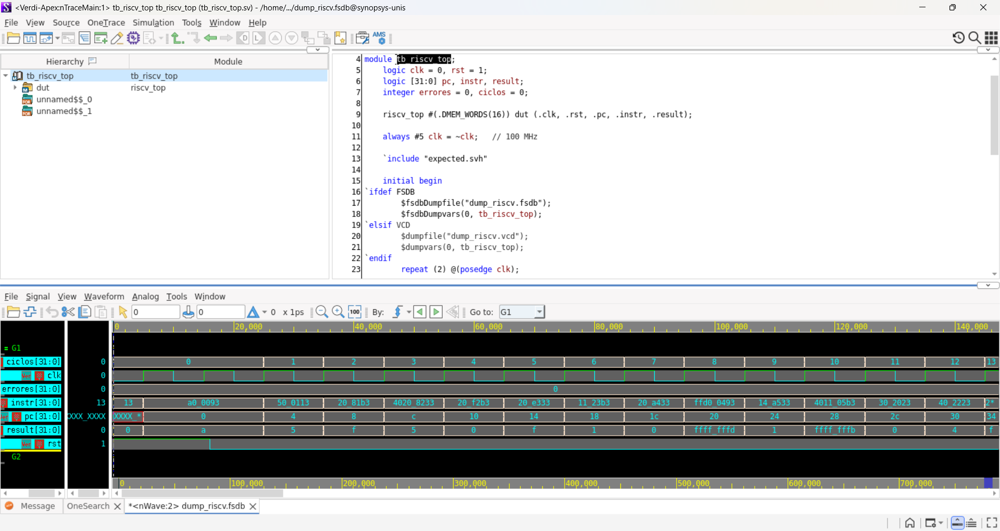

Programa completo (0 a 776 ns): `ciclos` llega a 73, `errores` se mantiene en 0 y `pc` termina en `a0`, el bucle final.

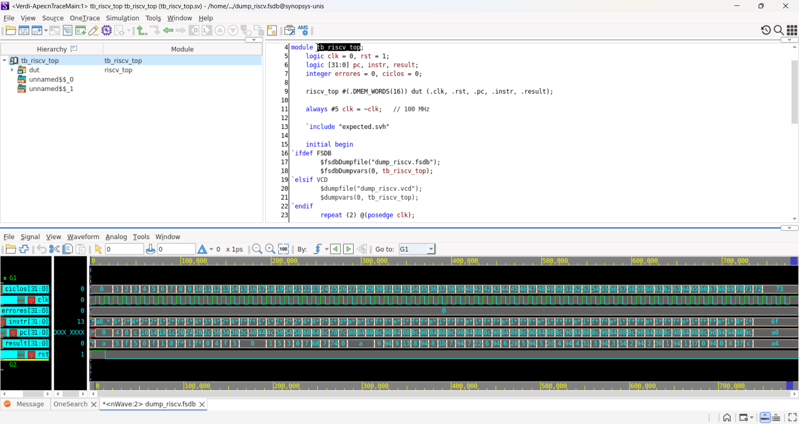

### Vivado: simulación

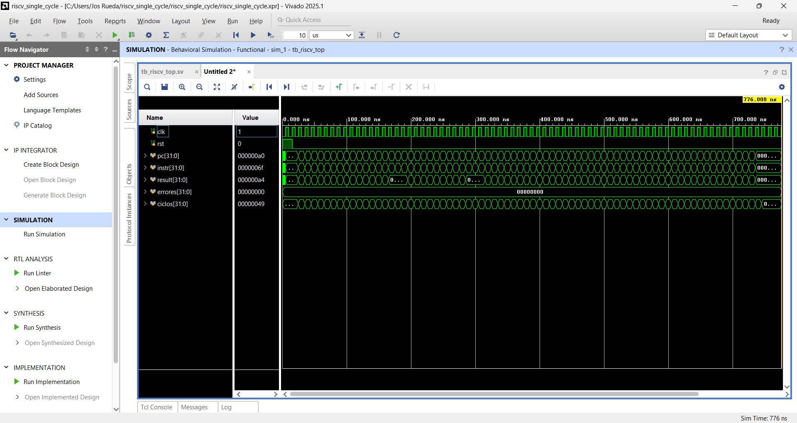

### Vivado: síntesis e implementación (xc7a35tcpg236-1)

| Recurso | Usado | Disponible | % |
|---|---|---|---|
| LUT | 498 | 20,800 | 2.39 |
| LUTRAM | 80 | 9,600 | 0.83 |
| FF | 32 | 41,600 | 0.08 |
| IO | 98 | 106 | 92.45 |
| BUFG | 1 | 32 | 3.13 |

Los 32 flip-flops son los del contador de programa. Vivado implementó el banco de registros y la memoria de datos como memoria distribuida (LUTRAM), por eso casi no usa FF. El IO es alto porque el módulo expone `pc`, `instr` y `result` (32 bits cada uno) además de `clk` y `rst`.

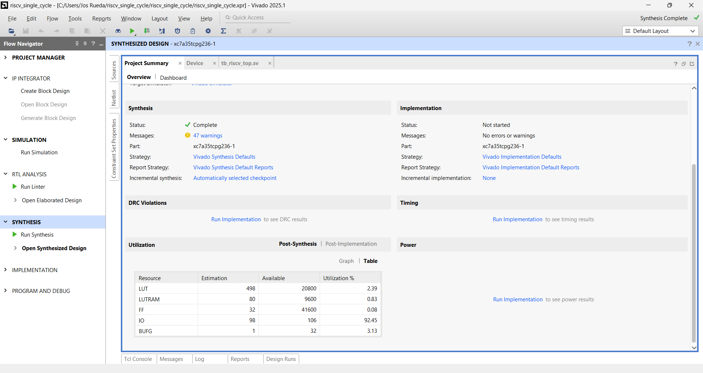

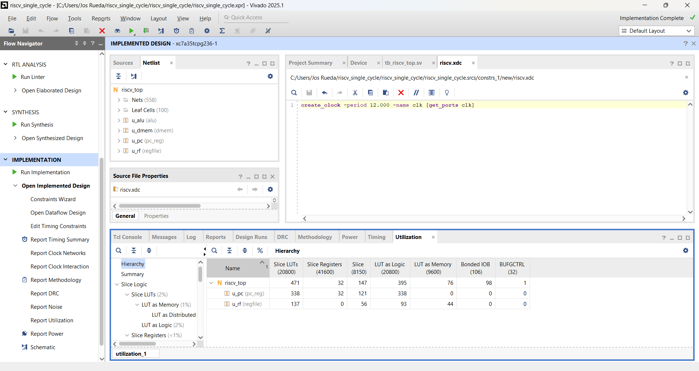

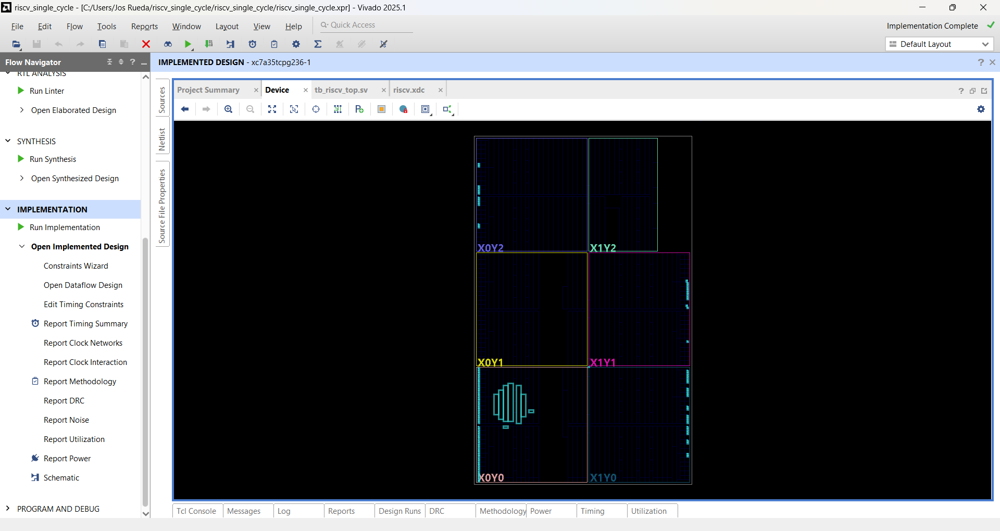

### Vivado: timing

| Periodo de reloj | Frecuencia | WNS (setup) | WHS (hold) | Resultado |
|---|---|---|---|---|
| 10 ns | 100 MHz | -0.907 ns | +0.277 ns | no cumple (84 caminos) |
| 12 ns | 83.3 MHz | **+0.331 ns** | +0.277 ns | cumple |

En un procesador single-cycle el periodo del reloj lo fija el camino más largo: leer la instrucción, leer registros, ALU, memoria de datos y escritura de vuelta. A 100 MHz ese camino no cabe (le faltan 0.907 ns); con 12 ns sí.

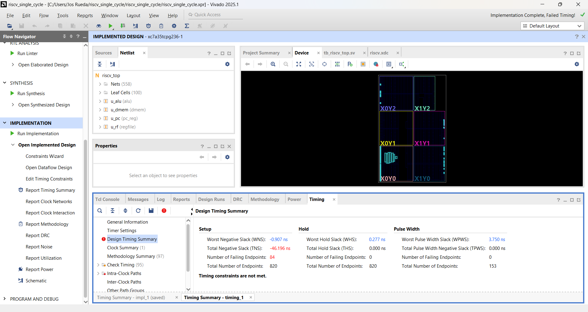

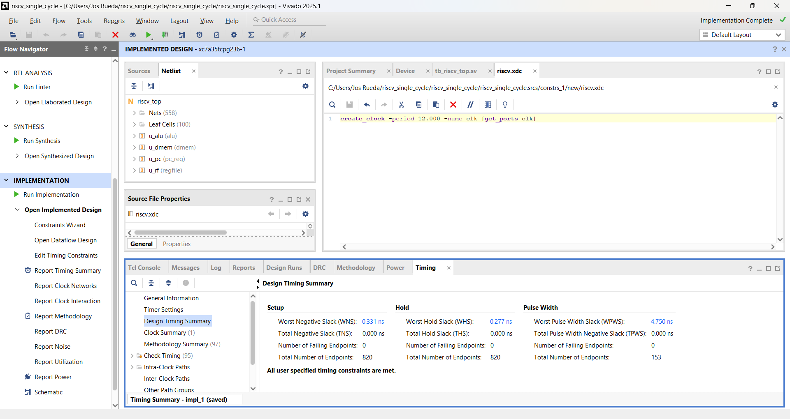

## Parte 2: diseño físico en Synopsys

Flujo: Design Compiler (síntesis) → VCS (simulación del netlist) → IC Compiler II (diseño físico). Librería de celdas M31LLSC750GL150MS, corner 25 °C / TT / 1.8 V. Todos los scripts, reportes y salidas están en la carpeta [`parte2_synopsys/`](parte2_synopsys/).

### Síntesis (Design Compiler)

Script: `dc_riscv.tcl`. El periodo del reloj se pasa con la variable `CLK`.

| Periodo | Resultado |
|---|---|
| 25 ns | No cumple: WNS -10.99 ns (ruta crítica de 28.49 ns hacia `result`, 30.28 ns hacia los registros) |
| 42 ns (~24 MHz) | Cumple: WNS 0.00, TNS 0.00, 0 rutas violadas (setup y hold) |

Con 42 ns el área es de 162,160 µm² y hay 1,536 flip-flops: 992 del banco de registros (x1 a x31), 512 de la memoria de datos y 32 del PC. A diferencia de Vivado, aquí el banco de registros y la memoria quedan como flip-flops y no como LUTRAM. La única línea marcada `VIOLATED` en `report_constraints.rpt` es `max_leakage_power`, una restricción por defecto en 0 que no definimos nosotros.

### Simulación del netlist sintetizado (VCS)

Se simuló `riscv_top_dc.v` con el modelo Verilog de las celdas M31 y el mismo programa de prueba: **0 errores, 73 ciclos**, con los mismos valores esperados que el RTL (x3=15, x4=5, suma 1..10 = 55, mem[2]=55, x30=7, x31=7).

DC convierte los arreglos en vectores planos (`regs[991:0]`, `mem[511:0]`) y numera el registro `r` desde el final, así que `tb_syn.sv` (copia del testbench) lee `regs[(31-r)*32 +: 32]` y `mem[(15-i)*32 +: 32]`. También usa un reloj de 100 ns, porque el diseño necesita unos 42 ns. Resultado en `parte2_synopsys/resultado_simulacion_postsintesis.log`.

### Diseño físico (IC Compiler II)

Script: `riscv_icc2.tcl`, con el netlist y el SDC generados por DC.

| Métrica | Valor |
|---|---|
| Utilización | 50.16 % (área de celdas 162,160 µm² sobre 323,260 µm²) |
| Nets ruteadas | 8,418 (0 abiertas) |
| Longitud de cable | 443,645 µm |
| Vías | 67,778 |
| DRCs | 0 |
| Cortos / nets abiertas (LVS) | 0 / 0 |

Salidas: `riscv_top_icc2.v` (netlist), `riscv_top.gds` y los reportes en `parte2_synopsys/reports_icc2/`.

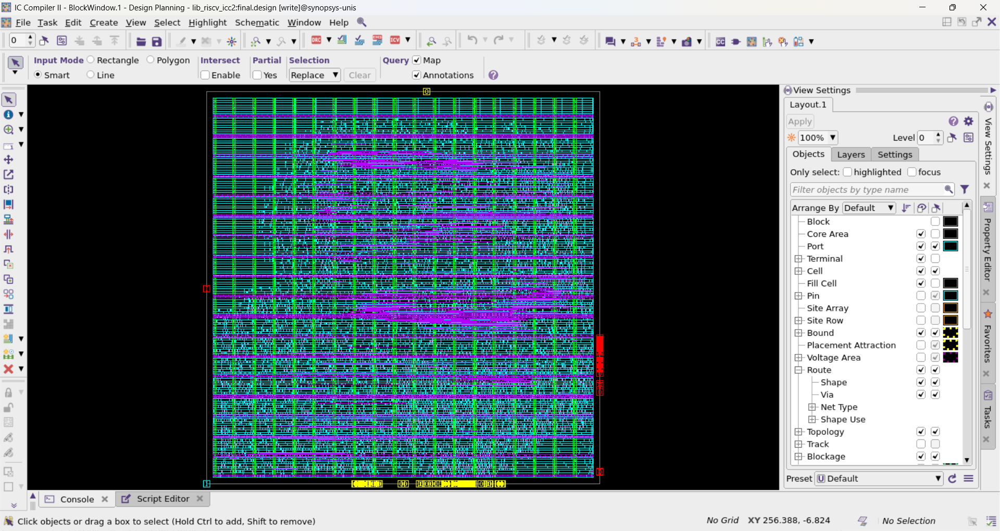

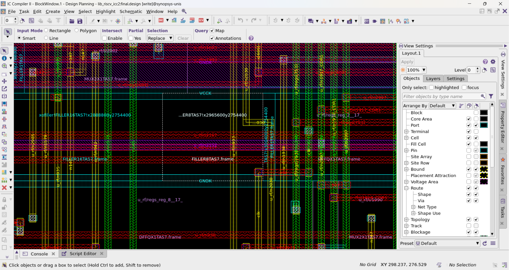

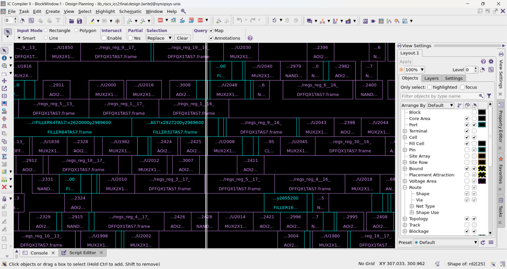

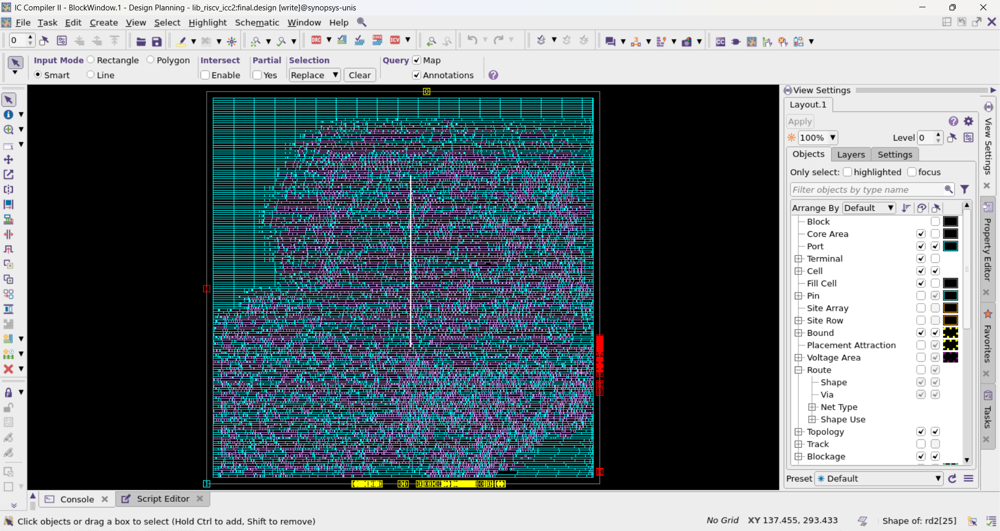

### Limitaciones de esta parte

- El kit M31 no incluye archivos de parásitos (TLU+), así que el árbol de reloj (`clock_opt`) no se pudo construir y no hay reporte de timing posterior al ruteo. El timing que se reporta es el de la síntesis.
- El GDS exportado no incluye el layout interno de las celdas estándar, solo el ruteo y la colocación.

## Limitaciones

- Subconjunto de RV32I: 10 instrucciones en total. No hay accesos a byte ni media palabra, ni CSR ni excepciones.
- La memoria de instrucciones es una ROM con un programa fijo, generada por `gen_program.py`. Para otro programa hay que regenerarla.
- La memoria de datos es de 16 palabras por defecto y no tiene control de alineación.
- Los puertos `pc`, `instr` y `result` existen solo para observar el procesador; por eso el diseño usa muchos pines de la FPGA.
